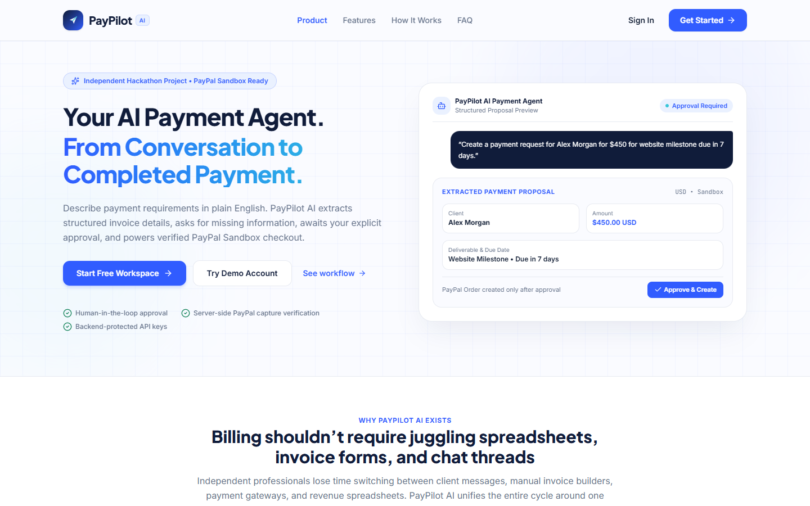
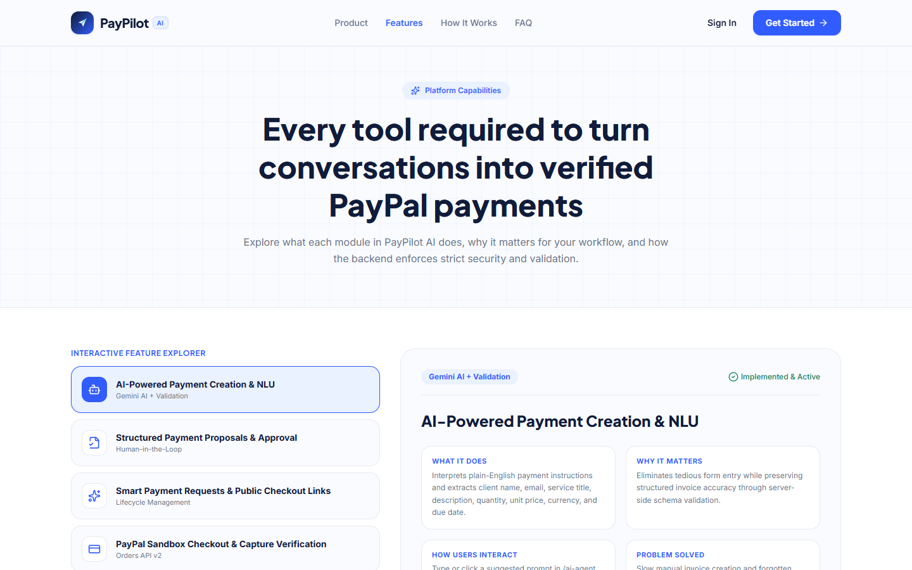
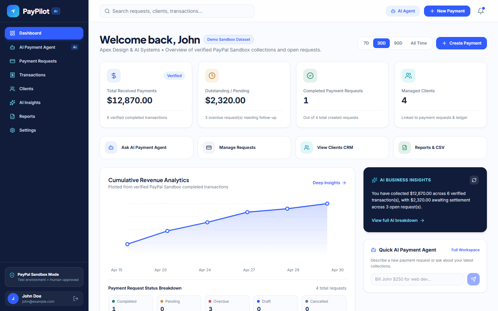
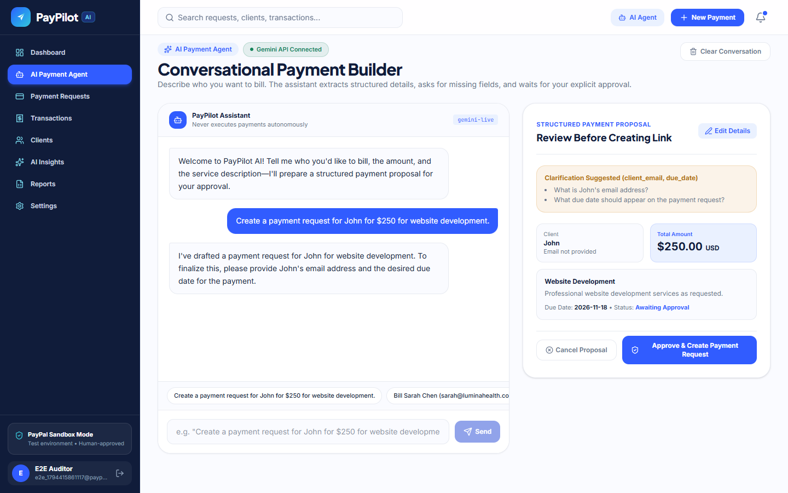
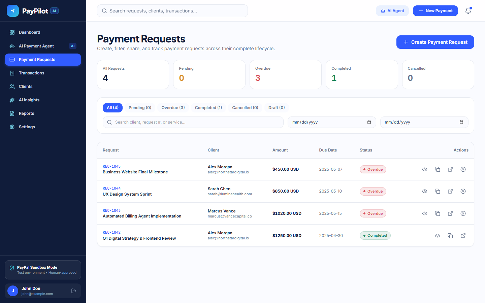
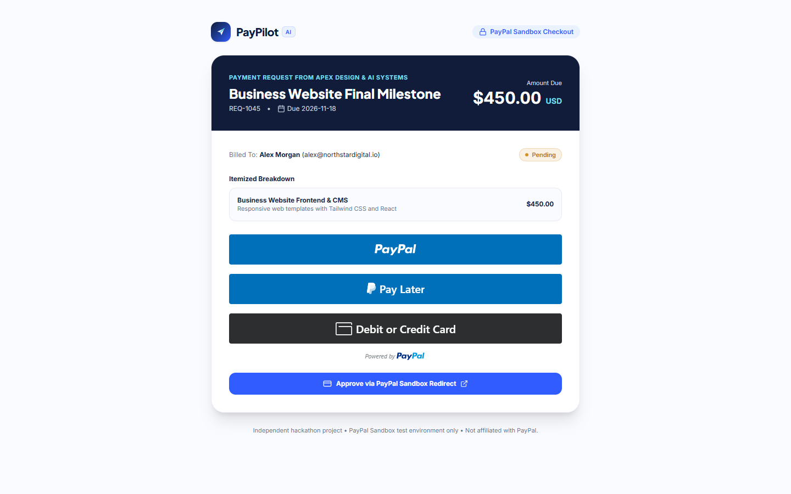
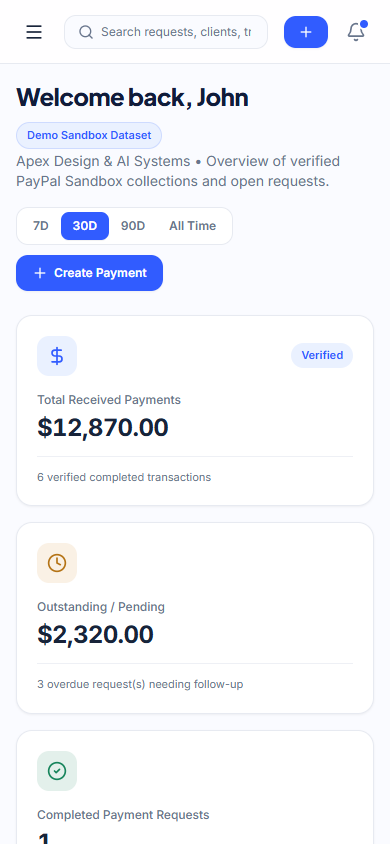
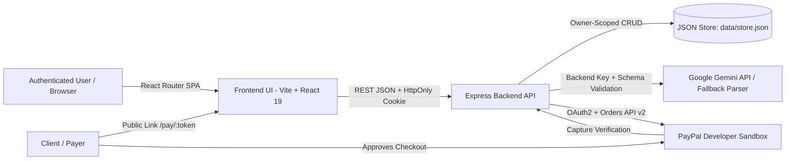

<div align="center">

# PayPilot AI

**Your AI Payment Agent. From Conversation to Completed Payment.**

[](LICENSE)
[](https://nodejs.org/)
[](https://react.dev/)
[](https://developer.paypal.com/)

*An independent hackathon project connecting natural-language AI workflows with human-approved PayPal Sandbox checkout, client CRM, and verified financial analytics.*

</div>

---

## 1. Project Overview

### Introduction
**PayPilot AI** is an AI-powered payment management platform designed for freelancers, independent consultants, and small businesses. Users describe payment requirements in plain English, review and approve AI-extracted payment proposals, share branded PayPal Sandbox checkout links, manage clients, separate open payment requests from verified transactions, and generate backend-grounded financial insights.

### Problem Statement
Independent professionals and lean teams often lose billable hours switching across chat threads, manual invoice templates, payment gateways, and spreadsheets:
- Creating itemized payment requests manually for every client milestone is repetitive.
- Missing client emails or due dates often surface only after a request is drafted.
- Mixing open payment requests with settled funds creates accounting confusion.
- Writing payment reminders and summarizing cashflow from raw records takes extra effort.

### Solution
PayPilot AI unifies conversational payment drafting, strict human-in-the-loop approval, PayPal Sandbox Orders API v2 verification, client tracking, and CSV reporting into a single cohesive web application.

### Target Users
- Freelancers billing project milestones
- Independent consultants managing retainers
- Small businesses & service providers tracking client receivables

---

## 2. Key Features

- **AI Payment Agent (`/ai-agent`)**: Extracts client name, email, service title, description, quantity, unit price, currency, and due date from natural language. Flags missing fields with clarification questions and enforces explicit human approval before creating a payment link.
- **Smart Payment Requests (`/payments`)**: Full lifecycle management (`DRAFT`, `PENDING`, `OVERDUE`, `COMPLETED`, `CANCELLED`), search, date filters, link copying/sharing, and safe cancellation/deletion dialogs.
- **PayPal Sandbox Checkout (`/pay/:token`)**: Public invoice view supporting PayPal JS SDK and Orders API v2 server-side order creation and capture verification. Never fabricates fake payment completions when credentials are absent.
- **Verified Transactions Ledger (`/transactions`)**: Dedicated ledger strictly separated from open payment requests, storing `paypalOrderId`, `paypalCaptureId`, verification reference, and timestamps.
- **Client Directory CRM (`/clients`)**: Add, edit, and safely delete clients, inspect per-client payment requests and transaction histories, and initiate billing directly from a client card.
- **AI Business Insights & Follow-Ups (`/insights`)**: Computes revenue, average ticket, pending/overdue totals, and client payment progress on the backend before passing verified numbers to Gemini for narrative insights and tone-customizable follow-up drafts.
- **Financial Reports & CSV Exports (`/reports`)**: Date-filtered revenue summaries, top-client breakdown, and one-click CSV downloads for Transactions, Payment Requests, and Clients.
- **Settings & Security (`/settings`)**: Profile/business editor, currency preference, notification toggles, password change, and live PayPal/Gemini configuration diagnostics.

---

## 3. Application Screenshots

### Landing Page (`/`)


### Features Explorer (`/features`)


### Main Dashboard (`/dashboard`)


### AI Payment Agent (`/ai-agent`)


### Payment Requests (`/payments`)


### Public PayPal Sandbox Checkout (`/pay/:token`)


### Mobile Responsive Dashboard (`390×844`)


---

## 4. Technology Stack

| Layer | Technology |
|---|---|
| **Frontend** | React 19, TypeScript, React Router DOM v7, Tailwind CSS v4, Motion (Framer Motion), Lucide Icons, Vite 8 |
| **Backend** | Node.js, Express 4, TSX, custom `crypto` (`scrypt` + HMAC-SHA256 session tokens) |
| **Database** | File-backed JSON store (`data/store.json`) with per-owner tenant isolation and atomic writes |
| **AI Integration** | Google Gemini (`@google/genai`) with structured JSON schema output + deterministic heuristic fallback |
| **Payment Integration** | PayPal Sandbox Orders API v2 (`/v1/oauth2/token`, `/v2/checkout/orders`, `/capture`) + PayPal JS SDK |
| **Testing & Tooling** | Node.js built-in test runner (`node:test` + `assert/strict`), TypeScript (`tsc --noEmit`), Playwright (UI/responsive QA) |

---

## 5. System Architecture & Folder Structure

PayPilot AI is built as a **single integrated full-stack Node.js application** (`server.ts`):
- In **development** (`npm run dev`), Express serves `/api/*` endpoints and mounts Vite middleware on port `3000` (only **one terminal** is required).
- In **production** (`npm run build` + `npm start`), Express serves the static `dist/` bundle alongside `/api/*` on port `3000`.

```text
paypilot-ai/
├── server.ts                  # Integrated Express + Vite entry point, CORS, rate limiters
├── server/
│   ├── db.ts                  # File-backed JSON Database class (auto-seeds data/store.json)
│   ├── types.ts               # Backend TypeScript interfaces
│   ├── middleware/auth.ts     # Strict HMAC-SHA256 session verification (401 on missing/invalid)
│   ├── utils/crypto.ts        # Salted scrypt password hashing & token signing
│   ├── services/
│   │   ├── gemini.ts          # Google Gemini API + timeout + JSON validation + fallback parser
│   │   └── paypal.ts          # PayPal Sandbox Orders API v2 + capture verification
│   ├── routes/                # auth, ai, clients, dashboard, paymentRequests, payments, reports
│   └── tests/api.test.ts      # Automated backend API & isolation tests (node:test)
├── src/
│   ├── App.tsx                # React Router v7 routes & global modals
│   ├── context/AuthContext.tsx
│   ├── components/            # BrandLogo, CreatePaymentModal, layout/, ui/
│   └── pages/                 # 16 public, auth, onboarding, workspace & checkout pages
├── docs/screenshots/          # Genuine application screenshots
├── .env.example               # Environment variable template
└── package.json               # Scripts: dev, start, build, lint, test
```



---

## 6. Application Pages (Frontend Routes)

| Route | Access | Purpose |
|---|---|---|
| `/` | Public | 14-section SaaS landing page with interactive AI showcase & FAQ |
| `/features` | Public | Interactive feature inspector and workflow comparison |
| `/how-it-works` | Public | Animated 7-stage payment lifecycle walkthrough |
| `/login` | Public | Email/password login + Demo Account sign-in |
| `/register` | Public | Account registration with live password strength meter |
| `/forgot-password` | Public | Token-based password recovery workflow |
| `/onboarding` | Protected | 2-step business profile and Sandbox readiness setup |
| `/dashboard` | Protected | KPIs, cumulative revenue chart, status breakdown, AI insights & quick actions |
| `/ai-agent` | Protected | Conversational payment builder with editable proposal & approval |
| `/payments` | Protected | Payment requests lifecycle table, search, date filters & sharing |
| `/transactions` | Protected | Verified PayPal Sandbox captures ledger & receipt modal |
| `/clients` | Protected | Client CRM directory, edit/delete, and per-client history |
| `/insights` | Protected | Backend-calculated financial insights & follow-up message generator |
| `/reports` | Protected | Revenue reports & CSV export for transactions, requests, and clients |
| `/settings` | Protected | Profile, currency, notification preferences, password & diagnostics |
| `/pay/:token` | Public | Customer-facing invoice & PayPal Sandbox checkout page |

---

## 7. Installation and Windows / Local Setup

### Prerequisites
- Node.js 20+ and npm 10+

### Windows (PowerShell) Setup

Because frontend and backend run inside one integrated Express + Vite server (`server.ts`), you only need **one terminal**.

1. **Clone the repository**
   ```powershell
   git clone https://github.com/Sahrish351/paypilot-ai.git
   cd paypilot-ai
   ```

2. **Install dependencies**
   ```powershell
   npm install
   ```

3. **Create `.env` from `.env.example`**
   ```powershell
   Copy-Item .env.example .env
   ```
   *(macOS / Linux equivalent: `cp .env.example .env`)*

   Open `.env` and set a strong `AUTH_SECRET`, plus optional `GEMINI_API_KEY` and PayPal Sandbox keys (`PAYPAL_CLIENT_ID`, `PAYPAL_CLIENT_SECRET`).

4. **Database initialization**
   No external database server or migration command is required. On first startup, `server/db.ts` automatically creates `data/store.json` with a seeded demo account (`john@example.com` / `demo1234`).
   - **Backup**: copy `data\store.json`.
   - **Reset to clean defaults**: stop the server and run `Remove-Item data\store.json`, then restart.

5. **Run the integrated application (development)**
   ```powershell
   npm run dev
   ```
   Open [http://localhost:3000](http://localhost:3000).

6. **Run tests, typecheck, and production build**
   ```powershell
   npm test
   npm run lint
   npm run build
   ```

7. **Run the production build (PowerShell)**
   ```powershell
   $env:NODE_ENV="production"; npm start
   ```

> **Demo Account Credentials:** `john@example.com` / `demo1234` (verified via real `scrypt` password hashing; also accessible via the **Sign In with Demo Account** button on `/login`). Newly registered users start with an empty, isolated workspace.

---

## 8. Environment Variables

See [`.env.example`](.env.example):

| Variable | Required | Description |
|---|---|---|
| `PORT` | No | Server port (defaults to `3000`) |
| `APP_URL` | No | Public base URL for PayPal return/cancel URLs (default `http://localhost:3000`) |
| `AUTH_SECRET` | Recommended | Secret string used to sign HMAC-SHA256 session tokens |
| `GEMINI_API_KEY` | Optional | Google Gemini API key; if omitted, AI Agent runs in transparent heuristic-fallback mode |
| `GEMINI_MODEL` | No | Gemini model identifier (defaults to `gemini-3-flash-preview`) |
| `PAYPAL_CLIENT_ID` | Optional | PayPal Developer Sandbox App Client ID (required for live Sandbox checkout) |
| `PAYPAL_CLIENT_SECRET` | Optional | PayPal Developer Sandbox App Secret (required for server-side order & capture) |
| `PAYPAL_BASE_URL` | No | PayPal API base URL (defaults to `https://api-m.sandbox.paypal.com`) |

---

## 9. API Documentation

All protected endpoints verify the signed `paypilot_session` HttpOnly cookie or `Authorization: Bearer <token>` header and return `401 Unauthorized` when unauthenticated.

| Method & Endpoint | Auth | Description |
|---|---|---|
| `GET /api/health` | Public | Returns service health, `geminiConfigured`, and `paypalSandboxConfigured` flags |
| `GET /api/payments/config` | Public | Returns PayPal Sandbox public readiness & `clientId` (if configured) |
| `POST /api/auth/register` | Public | Registers a new user with `scrypt`-hashed password & clean workspace |
| `POST /api/auth/login` | Public | Verifies credentials and issues signed session cookie & token |
| `GET /api/auth/session` | Public | Returns `{ authenticated, user }` without throwing 401 on public pages |
| `GET /api/auth/me` | Protected | Returns authenticated user profile (`401` if unauthenticated) |
| `PATCH /api/auth/profile` | Protected | Updates business profile, currency, and notification preferences |
| `POST /api/auth/change-password` | Protected | Verifies current password and updates to a new `scrypt` hash |
| `POST /api/auth/forgot-password` / `reset-password` | Public | Generates/consumes short-lived password reset token |
| `POST /api/auth/logout` | Public | Clears the `paypilot_session` cookie |
| `POST /api/ai/chat` | Protected | Parses natural language into validated `PaymentProposalPayload` |
| `GET /api/ai/history` / `POST /api/ai/clear-history` | Protected | Retrieves or resets the user's AI conversation history |
| `POST /api/ai/generate-reminder` | Protected | Generates tone-matched payment reminder drafts |
| `POST /api/ai/insights` | Protected | Computes real metrics on backend and generates executive insights |
| `GET/POST /api/clients` & `GET/PATCH/DELETE /api/clients/:id` | Protected | Owner-scoped Client CRM CRUD and history aggregation |
| `GET/POST /api/payment-requests` & `PATCH/DELETE /api/payment-requests/:id` | Protected | Payment request CRUD & `/cancel` state transition |
| `GET /api/payment-requests/public/:token` | Public | Fetches public checkout invoice metadata by `publicToken` |
| `POST /api/payments/create-order` | Public token / Owner | Creates PayPal Sandbox Order v2 (`503` if PayPal keys not set) |
| `POST /api/payments/capture-order` | Public / Owner | Captures approved PayPal Order v2, verifies status/currency/amount |
| `GET /api/payments` & `GET /api/payments/:id` | Protected | Lists verified completed/refunded transactions |
| `GET /api/dashboard/stats` & `/revenue` & `/notifications` | Protected | Returns real DB-computed KPIs, cumulative curve, and alerts |
| `GET /api/reports/export?type=transactions\|requests\|clients` | Protected | Streams CSV export for accounting and reconciliation |

---

## 10. Database Models

Stored in `data/store.json` (and configurable via `PAYPILOT_DB_FILE` for isolated tests):
- **User**: `id`, `name`, `email`, `passwordHash` (`scrypt$salt$hash`), `businessName`, `businessType`, `defaultCurrency`, `onboardingCompleted`, `notificationPreferences`, `isDemoAccount`.
- **Client**: `id`, `ownerId`, `name`, `email`, `company`, `notes`, `totalRequests`, `totalPaid`, `pendingAmount`, `lastPaymentDate`.
- **PaymentRequest**: `id`, `ownerId`, `clientId`, `requestNumber`, `title`, `description`, `lineItems[]`, `totalAmount`, `currency`, `dueDate`, `status` (`DRAFT` | `PENDING` | `OVERDUE` | `COMPLETED` | `CANCELLED`), `publicToken`, `paypalOrderId`.
- **Transaction**: `id`, `ownerId`, `paymentRequestId`, `paypalOrderId`, `paypalCaptureId`, `amount`, `currency`, `status`, `captureReference`, `capturedAt`.
- **AIChatMessage** & **NotificationItem**: Scoped per `ownerId`.

---

## 11. Payment Workflow (PayPal Sandbox)

1. Authenticated user approves a payment request (`PENDING`).
2. Client opens `/pay/:token`.
3. Frontend calls `POST /api/payments/create-order` with `publicToken`.
4. Backend obtains a PayPal OAuth2 token and creates a PayPal Sandbox order (`intent: "CAPTURE"`) using the stored server-side amount and `PayPal-Request-Id` idempotency key.
5. Client approves the payment via the PayPal Sandbox JS SDK or approval URL.
6. Backend calls `POST /api/payments/capture-order`, verifies `order.status === "COMPLETED"`, `capture.status === "COMPLETED"`, currency match, and exact amount match (`<= $0.01` tolerance).
7. Only after verification passes does the backend record a `Transaction`, mark the `PaymentRequest` as `COMPLETED`, update client totals, and emit a notification.

---

## 12. AI Workflow

1. User enters natural language in `/ai-agent` (e.g., `"Create a payment request for John for $250 for website development."`).
2. Backend sends prompt + system guardrails to Gemini (`gemini-3-flash-preview`) requesting structured JSON—or runs the deterministic fallback parser when `GEMINI_API_KEY` is unconfigured.
3. Server validates and clamps `quantity` (`1..10000`), `unit_price` (`> 0`), recalculates `total_amount = quantity * unit_price`, validates currency (`USD`, `EUR`, `GBP`, `CAD`, `AUD`), and detects missing fields (`client_email`, `due_date`, `amount`, `service_name`).
4. AI never executes payments autonomously; user must edit/confirm and click **Approve & Create Payment Request**.

---

## 13. Security Measures

- Passwords hashed with Node `crypto.scryptSync` + per-user 16-byte random salt.
- Session tokens signed with HMAC-SHA256 (`AUTH_SECRET`) and stored in `HttpOnly`, `SameSite=Lax` cookies.
- Strict `ownerId` scoping across all client, payment request, transaction, chat, and notification endpoints.
- Rate limiting on `/api/auth` and `/api/ai` routes plus security headers (`X-Content-Type-Options`, `X-Frame-Options`, `Referrer-Policy`).
- Gemini and PayPal secrets kept exclusively on the backend.

---

## 14. Testing

Run the automated backend API test suite, TypeScript typecheck, and production Vite build:

```bash
npm test
npm run lint
npm run build
```

The automated test suite (`server/tests/api.test.ts`) uses an isolated temporary database file (`PAYPILOT_DB_FILE`) and verifies:
- Service health & PayPal config readiness
- Strict `401` enforcement on unauthenticated workspace API routes
- Password verification & demo login
- New user registration, tenant isolation, client CRUD, AI proposal extraction, payment request lifecycle, honest `503` response when PayPal Sandbox credentials are absent, and CSV export.

---

## 15. Deployment

Deploy as a single full-stack Node.js web service (e.g., Render, Railway, Fly.io, or Cloud Run):
- Build command: `npm install && npm run build`
- Start command: `NODE_ENV=production npm start`
- Set `AUTH_SECRET`, `APP_URL`, `GEMINI_API_KEY`, `PAYPAL_CLIENT_ID`, and `PAYPAL_CLIENT_SECRET` in platform secrets.

---

## 16. Limitations

- **PayPal Sandbox Only**: Configured strictly for PayPal Developer Sandbox testing (`api-m.sandbox.paypal.com`); live real-money payouts are not enabled.
- **No External SMTP Provider**: Forgot-password reset tokens and notification emails are simulated in-app without an external email server.
- **File-Based Persistence**: Uses `data/store.json` rather than a managed database cluster; suitable for single-instance hackathon/demo deployments.
- **PayPal Webhooks**: Synchronous server-side capture verification is implemented; asynchronous webhook signature verification is not implemented in this version.

---

## 17. Hackathon Information

- **Project Name**: PayPilot AI
- **Description**: AI-powered payment management platform turning natural language into user-approved PayPal Sandbox payments.
- **Main Innovation**: Human-in-the-loop conversational invoice extraction paired with server-verified PayPal Sandbox captures and backend-calculated AI financial explanations.
- **GitHub Repository**: [https://github.com/Sahrish351/paypilot-ai](https://github.com/Sahrish351/paypilot-ai)
- **Disclaimer**: PayPilot AI is an independent hackathon project and is not affiliated with, sponsored by, or officially endorsed by PayPal.

---

## 18. License

Licensed under the [MIT License](LICENSE).
