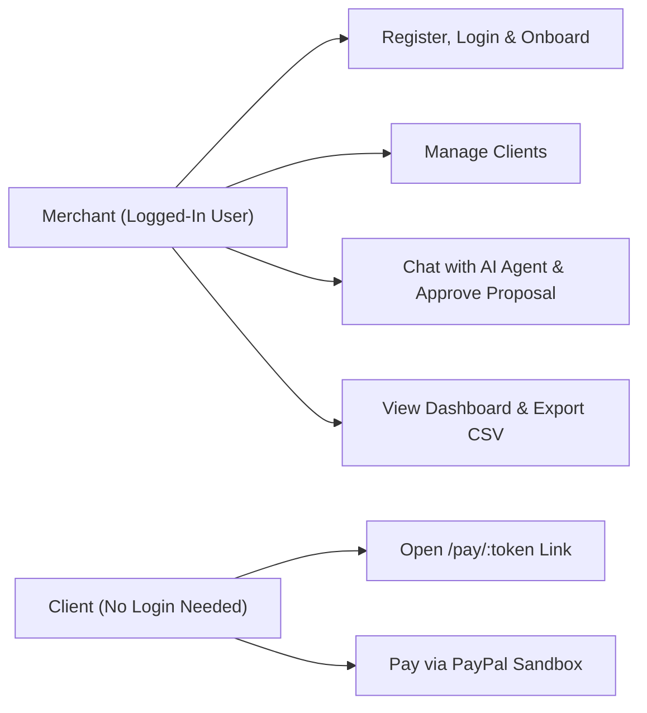
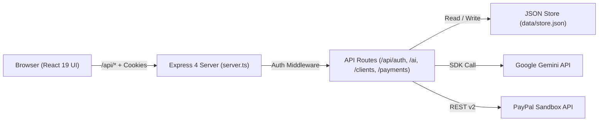
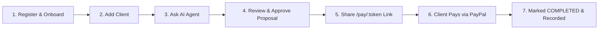
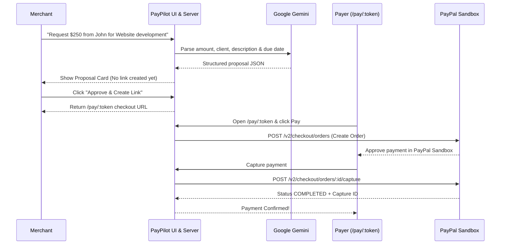
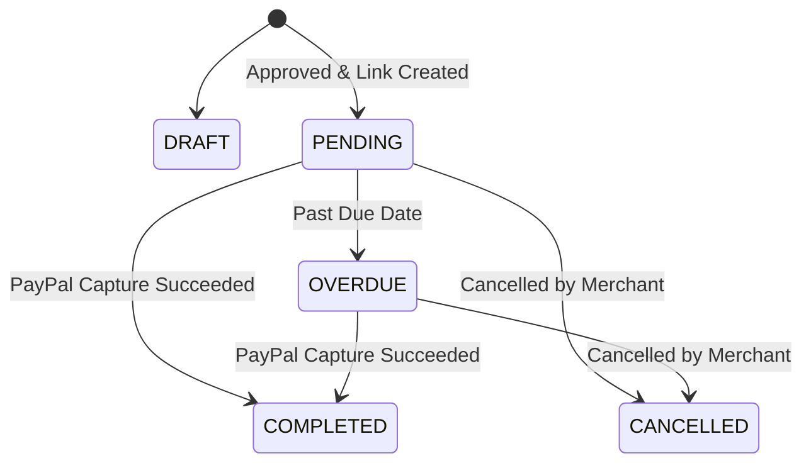
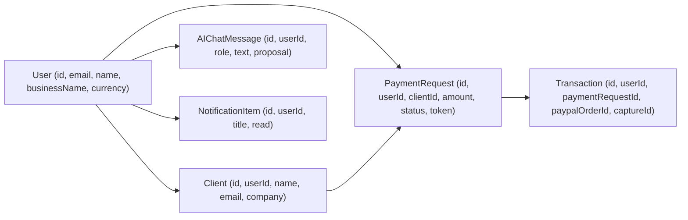

# PayPilot AI — Easy Project Guide for Team Members

**Tagline:** *Your AI Payment Agent. From Conversation to Completed Payment.*  
**Category:** AI-Powered Fintech Web Application  
**Architecture:** Integrated Full-Stack App (React 19 + Express 4 + Gemini AI + PayPal Sandbox)

---

## 1. Quick Overview

**PayPilot AI** is a web application that turns a normal English message into a structured payment request and lets the client pay online through **PayPal Sandbox**.

**Simple Example:**  
Instead of filling out a long invoice form manually, a freelancer types into the AI chat:
> *"Request $250 from John for website development due next week"*

PayPilot AI reads this message, finds John's saved details (if he is in the Clients list), creates a **Payment Proposal Card**, and waits for the user to click **Approve & Create Link**. Once approved, it generates a shareable checkout link (`/pay/:token`) where John can review the breakdown and pay via PayPal Sandbox.

---

## 2. Problem & Our Solution

### Why We Built This
- Creating invoices and payment links manually takes multiple steps across different tools.
- Chasing overdue payments requires writing polite reminder emails one by one.
- Small teams need one simple workspace to manage clients, requests, payments, and revenue reports.

### How PayPilot AI Solves It
| Traditional Process | PayPilot AI Approach |
| :--- | :--- |
| Fill long invoice forms manually | Type one sentence in plain English |
| Switch between chat, CRM, and PayPal | Manage clients, requests, and PayPal links in one place |
| Risk of AI sending wrong amounts | **Human-in-the-Loop:** AI only drafts a proposal; the user must approve it |
| Write follow-up emails manually | AI drafts payment descriptions and reminder messages in one click |
| Track transactions in spreadsheets | Automatic dashboard analytics, notifications, and CSV export |

---

## 3. Who Uses PayPilot AI?

There are two main users in the system:

1. **Merchant / Workspace Owner** (freelancers, agencies, small businesses): logs into the app, manages clients, chats with the AI Payment Agent, approves payment links, and tracks revenue.
2. **Client / Payer** (customer paying an invoice): does **not** need an account. Opens the public `/pay/:token` checkout link and pays using PayPal Sandbox.



---

## 4. Core Features

1. **Public Website (`/`, `/features`, `/how-it-works`):** Explains the product and links to registration and sign-in.
2. **Authentication & Onboarding (`/register`, `/login`, `/forgot-password`, `/onboarding`):** Secure account signup, login, password reset, and workspace setup.
3. **Dashboard (`/dashboard`):** Shows total revenue, pending volume, completion rate, recent transactions, revenue chart, and notification alerts.
4. **AI Payment Agent (`/ai-agent`):** Understands plain-English payment instructions via Google Gemini, asks follow-up questions if info is missing, and builds a **Payment Proposal Card** for manual user approval.
5. **Clients CRM (`/clients`):** Stores client name, email, company, and phone so the AI and forms can reuse them.
6. **Payment Requests (`/payments`):** Lists all payment requests, lets users create, edit, copy shareable links, download PDF/HTML-style print view or cancel requests, and tracks status (`DRAFT`, `PENDING`, `OVERDUE`, `COMPLETED`, `CANCELLED`).
7. **Public Checkout Page (`/pay/:token`):** Clean hosted invoice page with itemized details and PayPal Sandbox checkout (PayPal JS SDK buttons + Sandbox redirect flow).
8. **Transactions (`/transactions`):** Shows completed/captured payment records with PayPal Order IDs and Capture IDs.
9. **AI Insights & Reports (`/insights`, `/reports`):** Provides AI-generated business summaries and downloadable **CSV revenue exports**.
10. **Settings (`/settings`):** Lets users update profile details, currency, business name, and password.

---

## 5. Technology Stack

| Layer | Technology | Why We Use It |
| :--- | :--- | :--- |
| **Frontend** | React 19, TypeScript 5.8, Vite 8 | Fast, type-safe single-page web interface |
| **Styling & UI** | Tailwind CSS 4, Motion 12, Lucide React | Responsive layout, smooth animations, crisp icons |
| **Routing** | React Router v7 (`react-router-dom`) | Multi-page navigation between public and app views |
| **Backend** | Node.js, Express 4 (`server.ts`) | Serves REST APIs (`/api/*`) and the frontend app |
| **AI Engine** | Google Gemini (`@google/genai`) | Parses natural-language instructions, drafts descriptions & reminders |
| **Payments** | PayPal Checkout REST API v2 + JS SDK | Creates and captures real PayPal Sandbox test orders |
| **Data Storage** | File-backed JSON store (`data/store.json`) | Lightweight zero-setup persistence without needing an external DB |
| **Auth & Security** | `scryptSync` + HMAC-SHA256 `HttpOnly` cookie | Secure password hashing and session verification |

---

## 6. System Architecture

PayPilot AI runs as **one integrated application** (`server.ts` starts Express on port `3000` and mounts the React frontend via Vite in development or static `dist/` in production).



### How It Works Together
- **Frontend (`src/`):** Shows pages, forms, charts, and chat UI. Calls `/api/*` endpoints.
- **Backend (`server.ts`, `server/routes/`):** Checks user login cookies, isolates each user's data by `userId`, validates inputs, calls Gemini or PayPal safely on the server, and saves records to `data/store.json`.
- **Why Server-Side Secrets Matter:** `GEMINI_API_KEY`, `PAYPAL_CLIENT_SECRET`, and `AUTH_SECRET` stay only on the backend and are never exposed to the browser.

---

## 7. Main Workflows & Diagrams

### A. End-to-End User Workflow


### B. AI Proposal & PayPal Payment Sequence


### C. Payment Request Status Lifecycle


---

## 8. Data Structure & Key API Routes

### Core Data Entities (`server/types.ts` stored in `data/store.json`)


### Key Backend Endpoints
| Area | Base Path | Main Actions |
| :--- | :--- | :--- |
| **Health** | `/api/health` | `GET` server & config readiness check |
| **Auth** | `/api/auth` | `POST /register`, `POST /login`, `POST /logout`, `GET /me`, `PATCH /profile` |
| **AI Agent** | `/api/ai` | `POST /chat`, `GET /history`, `POST /generate-description`, `POST /generate-reminder`, `POST /insights` |
| **Clients** | `/api/clients` | `GET /`, `POST /`, `PATCH /:id`, `DELETE /:id` |
| **Requests** | `/api/payment-requests` | `GET /public/:token`, `GET /`, `POST /`, `PATCH /:id`, `POST /:id/cancel`, `DELETE /:id` |
| **PayPal** | `/api/payments` | `GET /config`, `POST /create-order`, `POST /capture-order`, `GET /` |
| **Dashboard & Reports** | `/api/dashboard`, `/api/reports` | `GET /stats`, `GET /revenue`, `GET /notifications`, `GET /export` (CSV) |

---

## 9. Security & PayPal Sandbox Guide

### Built-In Security Measures
- **Password Hashing:** Passwords use Node's `crypto.scryptSync` with random salt and timing-safe checks.
- **Session Protection:** Signed HMAC-SHA256 tokens stored in `HttpOnly`, `SameSite=Lax` cookies.
- **User Data Isolation:** Protected APIs require `authMiddleware` (`401` if not signed in) and scope data strictly to `req.user.id`.
- **Rate Limiting:** Auth endpoints (`30/min`) and AI endpoints (`40/min`) prevent spam and abuse.

### Understanding PayPal Sandbox (Why It Asks for Payer Login)
When clicking **Pay with PayPal** or **Approve via PayPal Sandbox Redirect**, PayPal opens a test login screen. This is **normal PayPal security** — PayPal never deducts money without the buyer logging in to approve it:
- **Sandbox Business Account (App Owner):** Receives the test funds (`PAYPAL_CLIENT_ID` & `PAYPAL_CLIENT_SECRET` in `.env`).
- **Sandbox Personal Account (Buyer/Payer):** A test buyer email/password from **PayPal Developer Dashboard -> Testing Tools -> Sandbox Accounts** used on `/pay/:token` to simulate a real client paying.

---

## 10. Quick Local Setup (Windows PowerShell)

### 1. Prepare Environment Variables
Copy the safe template and add your keys inside `.env` (never commit `.env` to GitHub):
```powershell
Copy-Item .env.example .env
```

| Variable | Purpose |
| :--- | :--- |
| `PORT` | Server port (default `3000`) |
| `APP_URL` | Base URL (`http://localhost:3000` locally) |
| `AUTH_SECRET` | Random secret string for signing session cookies |
| `GEMINI_API_KEY` | Google Gemini API key for AI features |
| `GEMINI_MODEL` | Model name (e.g., `gemini-2.5-flash`) |
| `PAYPAL_CLIENT_ID` | PayPal Sandbox app Client ID |
| `PAYPAL_CLIENT_SECRET` | PayPal Sandbox app Secret |
| `PAYPAL_BASE_URL` | `https://api-m.sandbox.paypal.com` for testing |
| `PAYPILOT_DB_FILE` | Path to JSON store (default `data/store.json`) |

### 2. Install, Test & Run
```powershell
npm install
npm run dev      # Starts Express + Vite at http://localhost:3000
npm test         # Runs unit & API integration tests
npm run lint     # Runs TypeScript type-check (tsc --noEmit)
npm run build    # Builds production frontend bundle (dist/)
```

---

## 11. Testing Status Summary

| Area | Status | Notes |
| :--- | :---: | :--- |
| TypeScript (`npm run lint`) & Build (`npm run build`) | **PASS** | Clean build with zero errors |
| Automated API & Isolation Tests (`npm test`) | **PASS** | Auth, client isolation, payments, PayPal create/capture flow |
| Live Browser Route & Flow Verification | **PASS** | Landing, Auth, Dashboard, AI Agent, Clients, Requests, Checkout |
| Live PayPal Sandbox Buyer Capture | **Ready for Test Account** | Order creation works; full buyer approval uses a PayPal Sandbox Personal buyer login |

---

## 12. Quick FAQ, Glossary & Team Pitch

### Short FAQ
- **Does the AI ever send a payment request automatically?** No. It creates a proposal first and waits for the user to click **Approve & Create Link**.
- **Does a paying client need a PayPilot account?** No. They pay directly on the public `/pay/:token` page.
- **Where is data saved?** In `data/store.json` (can be upgraded to PostgreSQL/MongoDB later without changing the frontend).

### Simple Glossary
- **Payment Request:** An invoice/link waiting to be paid (`PENDING` or `OVERDUE`).
- **Transaction:** A confirmed payment record created after PayPal capture (`COMPLETED`).
- **Sandbox Mode:** PayPal's safe test environment using fake test money.
- **Capture Order:** The final backend step that collects the payment after buyer approval.

### 30-Second Pitch for Hackathon Judges
> *"PayPilot AI is an AI-powered payment agent that takes freelancers and small businesses from a simple English sentence to a completed PayPal payment. You just tell the AI who to bill and why, review and approve its proposal with one click, and share a hosted PayPal checkout link—complete with automated client memory, reminders, dashboard analytics, and CSV reporting."*
